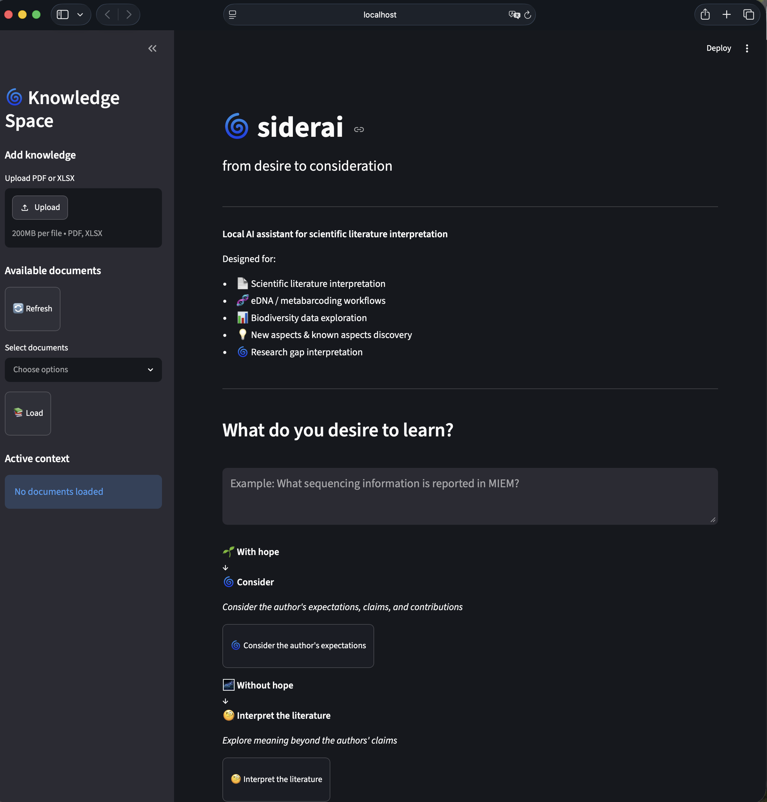

# SiderAI

Local AI assistant for scientific literature analysis using Retrieval-Augmented Generation (RAG).

## Overview

SiderAI is a local AI assistant that helps researchers extract and explore information from scientific literature — without sending data to the cloud. It runs entirely on your own machine, making it suitable for unpublished manuscripts, sensitive datasets, and specialized scientific documents.

It is built around a Retrieval-Augmented Generation (RAG) pipeline, combining local language models (via Ollama) with a semantic search layer to answer questions grounded in the actual content of your papers.

SiderAI is being developed with ecological and environmental research in mind — particularly for workflows involving environmental DNA (eDNA), metabarcoding, biodiversity monitoring, and lake ecology.

## Screenshot



## Motivation

Environmental metabarcoding and eDNA studies generate large volumes of methods, metadata, and results that are difficult to navigate manually. Standards such as the [MIEM guidelines](https://doi.org/10.3897/mbmg.8.128689) highlight the importance of transparent, reproducible reporting — but locating specific information across publications remains time-consuming.

SiderAI is designed to help researchers:

* extract methods, results, taxa, or reporting criteria from papers,
* ask plain-language questions about workflow steps (e.g. extraction protocols, bioinformatic parameters),
* and compare findings or metadata requirements across multiple publications.

Rather than replacing careful reading, SiderAI aims to support it — making it easier to navigate dense scientific literature efficiently and reproducibly.

## How It Works

SiderAI follows a simple RAG pipeline: your PDF is parsed, split into chunks, and stored as embeddings in a local Qdrant vector database. When you ask a question, the most relevant chunks are retrieved and passed to a local language model (via Ollama), which generates an answer based only on your documents — nothing leaves your machine.

<p align="center">
  <strong>Scientific paper (PDF)</strong><br>
  ↓<br>
  <strong>Text extraction and preprocessing</strong><br>
  ↓<br>
  <strong>Document chunking</strong><br>
  ↓<br>
  <strong>Embedding generation</strong><br>
  ↓<br>
  <strong>Qdrant vector database</strong><br>
  ↓<br>
  <strong>Semantic retrieval</strong><br>
  ↓<br>
  <strong>Local LLM (Ollama)</strong><br>
  ↓<br>
  <strong>Scientific answer</strong>
</p>

## Current Capabilities

* Parse and index scientific papers (PDF)
* Ask plain-language questions about your literature
* Extract taxa, methods, results, and summaries
* Semantic search across indexed documents
* Organize publication metadata locally

**Example questions:**
* "What extraction method was used in this study?"
* "Which taxa were detected using metabarcoding?"
* "What bioinformatic pipeline and parameters were reported?"
* "Summarize the Results and Discussion sections."
* "Does this study follow MIEM reporting guidelines?"

## Project Structure

The repository contains the core components of the SiderAI pipeline:

* `app.py` provides the main application interface.
* The `rag/` directory contains the retrieval-augmented generation workflow, including document ingestion, indexing, retrieval, and question-answering scripts.
* The `papers/` directory stores processed scientific documents.
* The `metadata/` directory contains structured information about analyzed publications.
* The `scripts/` directory includes supporting utilities for metadata creation and enrichment.

The vector database generated by Qdrant is stored locally and excluded from version control.

## Local Installation

### 1. Create and activate a Python environment

SiderAI currently uses Python 3.11.

```bash
conda create -n research_ai python=3.11
conda activate research_ai
```

### 2. Install Python dependencies

From the SiderAI project directory:

```bash
pip install -r requirements.txt
```

### 3. Install and start Ollama

SiderAI uses Ollama as a local inference server. **Ollama is a separate application and must be installed and running before using SiderAI.**

Install Ollama from the official Ollama website.

SiderAI currently uses two Ollama models:

* `nomic-embed-text:latest` for document and query embeddings
* `qwen3:8b` for local language model inference

Download the required models:

```bash
ollama pull nomic-embed-text:latest
ollama pull qwen3:8b
```

Start the Ollama server:

```bash
ollama serve
```

Keep the Ollama server running while using SiderAI.

You can verify that the required models are available with:

```bash
ollama list
```

You should see both:

```text
nomic-embed-text:latest
qwen3:8b
```

### 4. Run SiderAI

Open a new terminal and activate the environment:

```bash
conda activate research_ai
cd siderai
```

Start the Streamlit application:

```bash
streamlit run app.py
```

SiderAI will open in your local web browser.

### 5. Create the document index

To ingest and index scientific literature:

```bash
python rag/ingest.py
```

### 6. Ask questions about indexed literature

```bash
python rag/ask.py
```

## Ollama Models

| Model                     | Purpose                                                |
| ------------------------- | ------------------------------------------------------ |
| `nomic-embed-text:latest` | Document and query embeddings                          |
| `qwen3:8b`                | Local language model for generating scientific answers |

Both models run locally through Ollama.

## Data Privacy

All documents, embeddings, and queries stay on your local machine. Nothing is sent to external servers.

## Future Development

* Multi-paper knowledge bases for literature-wide comparisons
* Automated extraction of reporting metadata (e.g. primers, extraction kits, bioinformatic parameters)
* Support for MIEM and FAIR data standard compliance checking
* Integration with biodiversity and lake ecology datasets
* Improved table and figure extraction
* MCP-compatible interface for AI-ready research workflows

## Author

Onur Doğan

